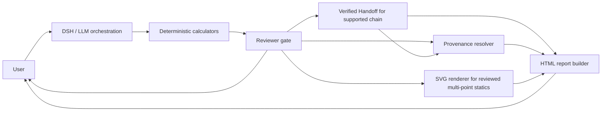

# Mechanical Design Agent

**Project target:** v0.3.0 (release-preparation candidate; not yet released) · **Published baseline:** v0.2.0 · **License:** [MIT](LICENSE)

## Start here (Windows)

1. Double-click [start-mechanical-dsh.cmd](start-mechanical-dsh.cmd) in this folder.
2. Wait for the browser to open automatically.
3. Enter the **mechanical** session.
4. Describe the mechanical problem in ordinary language. For example:

> Analyze verified two-plane shaft strength: power 5.5 kW, speed 960 rpm, simply supported span 600 mm, plane 1 signed point load -1000 N at 200 mm, plane 2 signed point load -1000 N at 400 mm, allowable shear stress 40 MPa. Report the same-station critical resultant and both critical positions, the signed plane components, all three Reviewer statuses, and the theoretical minimum diameter.

The launcher builds the local plugin and starts the restricted Web runtime. Keep its terminal window open while using the session. Initial developer setup and prerequisites are in [Developer setup](#developer-setup).

## Supported verified workflows

- Transmitted torque from power and speed.
- The existing one-plane, simply supported point-load shaft-strength workflow.
- Signed two-plane, simply supported point-load shaft-strength workflow. Its resultant combines the two bending components **at the same shaft station**.
- Explicit opt-in: verified overhung two-plane shaft screening with bound Reviewer evidence, original-request binding, four-model provenance and exact Verified Handoff. See [the overhung workflow](docs/VERIFIED_OVERHUNG_SHAFT_WORKFLOW.md).

The reported `d_min` is a **theoretical minimum strength diameter**, not a selected production diameter. Actual design still needs a preferred diameter choice and checks for stress concentration, fatigue, stiffness, and bearing or other machine-element fit.

The default workflows cover loads on or between simple supports. The explicit overhung workflow also covers signed transverse point loads across the supported overhung shaft domain, with explicit acceptance of constant torque over the shaft. These workflows do not cover distributed loads, applied couples, axial loads, fatigue, stress concentration, automatic material selection, production diameter selection, deflection, critical speed, bearings, gear or belt load generators, CATIA, or CAE.

This is an experimental engineering agent. Deterministic Python calculators supply numerical results, Reviewer gates validate them, Verified Handoff preserves exact values through supported chains, and the Registry supplies provenance. The LLM explains reviewed results; it does not calculate engineering values.

## How It Works



Standalone calculations proceed from calculator to Reviewer and provenance. Verified Handoff is used for the supported torque + multi-point statics → combined strength chain. SVG and HTML output are optional presentation stages with narrower input requirements; the report builder requires the complete reviewed chain, provenance, and both SVG diagrams.

## Design Principles

1. **Calculator JSON is numerical truth.** Engineering numbers come from deterministic Python calculators, never from LLM arithmetic.
2. **Reviewer is the validation gate.** Deterministic checks independently test equations, equilibrium, input ranges, inverse relations, and result consistency as applicable to each model. A failed result stops the supported workflow.
3. **Provenance is source truth.** The resolver maps a calculator's `model_id` to an Engineering Model Card and registered sources. It does not calculate results.
4. **Verified Handoff is lineage truth.** In the supported chain, reviewed upstream JSON is passed directly to a deterministic workflow that transfers exact torque and maximum-moment values into combined sizing and reviews the result.
5. **The LLM orchestrates.** It identifies the task, selects supported models, invokes tools, and explains reviewed outputs.

## Current Capabilities

| Capability | Status |
| --- | --- |
| Transmitted torque from power and speed | Supported |
| Solid shaft theoretical minimum diameter under pure torsion | Supported |
| Solid shaft theoretical minimum diameter under combined steady bending and torsion | Supported |
| Simply supported, single-point shaft statics | Supported |
| Simply supported, multiple same-direction point-load statics | Python V1 model |
| Simply supported signed point-load and two-plane statics | Verified two-plane Native workflow |
| Piecewise shear and bending-moment data | Python multi-point model |
| Shear-force and bending-moment SVG diagrams | Python reviewed multi-point model |
| Engineering Model Cards and provenance resolver | Nine registered models |
| Deterministic engineering Reviewer | Nine registered models |
| Verified cross-calculator handoff | One-plane, two-plane and explicit overhung torque + statics → combined sizing |
| Two-support overhung signed and two-plane statics | Python models; explicit verified Native workflow |
| Deterministic HTML engineering report | Python V1 multi-point shaft chain |
| DSH restricted Web session | Default: three engineering operations in an 11 Tool profile |
| Explicit overhung headless session | Four engineering operations in a 12 Tool profile |

### Supported Engineering Models

| `model_id` | Purpose |
| --- | --- |
| `transmitted_torque_v1` | Torque from power and rotational speed |
| `solid_shaft_pure_torsion_v1` | Theoretical solid-shaft diameter under pure torsion |
| `solid_shaft_combined_tresca_v1` | Theoretical solid-shaft diameter under steady bending and torsion |
| `simply_supported_point_load_v1` | Reactions and maximum moment for one transverse point load |
| `simply_supported_multi_point_load_v1` | Reactions and piecewise shear/moment for multiple transverse point loads |
| `simply_supported_signed_multi_point_load_v1` | Signed reactions and bending in one transverse plane |
| `simply_supported_two_plane_point_load_v1` | Same-station resultant from two orthogonal signed point-load planes |
| `two_support_overhung_signed_point_load_v1` | Signed one-plane reactions and bending across two supports and overhangs |
| `two_support_overhung_two_plane_point_load_v1` | Same-station resultant across two signed overhung planes |

The detailed assumptions and source relationships are in [Engineering Model Cards](knowledge/models/) and the [source registry](knowledge/sources.toml).

## End-to-End Example

For **5.5 kW** at **960 rpm**, a **600 mm** simply supported span with **1000 N at 200 mm** and **500 N at 450 mm**, and **40 MPa** allowable shear stress, the verified workflow yields:

| Reviewed output | Value |
| --- | --- |
| Transmitted torque `T` | `54.713541666666664 N·m` |
| Left reaction `RA` | `791.6666666666667 N` |
| Right reaction `RB` | `708.3333333333333 N` |
| Maximum bending moment `Mmax` | `158.33333333333334 N·m` |
| Theoretical minimum diameter `d_min` | `27.732717671613003 mm` |

The same reviewed multi-point statics data can produce shear-force and bending-moment SVGs. The complete chain can also produce a deterministic, single-file HTML engineering report with those diagrams. The diameter is a theoretical strength result, not a selected production diameter.

## Reproducible V1 Demo

See [examples/v1-shaft-analysis/](examples/v1-shaft-analysis/) for the original one-plane workflow and [examples/v0.2-two-plane-shaft-analysis/](examples/v0.2-two-plane-shaft-analysis/) for the signed two-plane workflow. Both are deterministic reproductions without an LLM session.

## Why the Results Are Not Calculated by the LLM

The LLM chooses and sequences the tools and explains their results. Python calculators compute engineering values; the Reviewer checks them; the provenance resolver identifies each model's assumptions and sources. During development, a chained LLM run introduced an incorrect intermediate bending moment while the downstream calculator remained internally consistent. Verified Handoff was added so the LLM does not manually retype upstream engineering values into downstream calculators. This layer applies to the supported torque + multi-point statics → combined sizing chain.

## Developer setup

The Python and Plugin project versions target **0.3.0**. The separate DSH runtime, DSH Tools and Win32 process provider stay pinned to **0.2.0-rc.2**; project and runtime version numbers are not interchangeable. Both Python execution paths require the exact project version reported from this checkout's `pyproject.toml`. An old or unproven project version is an environment compatibility failure, not evidence of a Calculator regression.

Source project identity and installed distribution metadata are separate checks. This round did not reinstall the project; an existing environment may retain older `importlib.metadata`/pip metadata. Verify the actual probe's project version and source path for this source-based runtime. Do not treat this check as proof that a v0.3 distribution was installed or packaged.

Requirements: Python >=3.12, Node >=24, Windows x64 for the overhung Supervisor, functioning creation-time Job-list attributes and nested Jobs, DSH/DSH Tools/Win32 process provider 0.2.0-rc.2, and Koffi **3.1.1**. Koffi is an existing pinned dependency of the Win32 provider. The engineering Job has no weaker fallback. Tests also need pytest; the source build uses Node's built-in TypeScript stripping and needs no separate TypeScript compiler.

The verified local reproduction environment is Windows 11 x64 (10.0.26200), Node 24.18.0, Python 3.14.6, pytest 9.0.3, setuptools 83.0.0, Schemastery 3.18.4 and the pinned components above. Reproduction used a clean source copy and an existing dependency cache, without installing or upgrading dependencies. It does **not** prove fresh-machine installation, all Windows versions, or the minimum Python/Node versions. There is no complete npm lock file; dependency resolution on a new machine remains a release risk. Registry lookup requires the source checkout's `knowledge/` directory; wheel packaging of that data is deferred. The package is not published to a package index.

For initial setup, create and activate a compatible Python environment; [environment.yml](environment.yml) provides the Python 3.12/pytest Conda specification. The documented source-install command below is setup guidance; it was not rerun during this cache-based release-preparation check:

```powershell
python -m pip install -e .
```

Run a torque calculation:

```powershell
python -m mechanical_agent.calculators.torque --power-kw 5.5 --speed-rpm 960
```

Run multi-point statics and review the original calculator JSON:

```powershell
$statics = python -m mechanical_agent.calculators.shaft_statics_multi --span-mm 600 --load "1000@200" --load "500@450"
$review = $statics | python -m mechanical_agent.review.engineering_result
if ($LASTEXITCODE -ne 0 -or ($review | ConvertFrom-Json).status -ne "PASS") { throw "statics review failed" }
$statics
```

Each calculator prints machine-readable JSON with a `model_id`. The Reviewer prints JSON containing `status` and individual checks. For the full chained workflow, see the contracts in [.dsh/skills/](.dsh/skills/); the handoff implementation is in [src/mechanical_agent/workflows/](src/mechanical_agent/workflows/).

## Using with DeepSeek Harness

The five project Skills in [.dsh/skills/](.dsh/skills/) define orchestration contracts:

- `transmission-torque`
- `solid-shaft-torsion`
- `combined-shaft-loading`
- `shaft-point-load-statics`
- `shaft-multi-point-load-statics`

### Development profile

From the repository root, use the unpatched `headless` profile for development tasks, tests, and artifact generation:

```powershell
npx.cmd --yes @deepseek-ai/dsh@0.2.0-rc.2 --profile headless --json "Calculate transmitted torque for 5.5 kW at 960 rpm."
```

### Verified Mechanical Engineering profile

For initial setup, the existing dependency-install command is `npm install --prefix packages/dsh-mechanical-plugin`. It is not a fresh-install verification result. With compatible dependencies already present and Python activated, run from the repository root:

```powershell
$env:MECHANICAL_AGENT_PYTHON = (python -c "import sys; print(sys.executable)").Trim()
$env:MECHANICAL_AGENT_TEST_PYTHON = $env:MECHANICAL_AGENT_PYTHON
node scripts/verify_v15_runtime.mjs
```

The health check forces the existing nine memory-pressure scenarios to be skipped, runs all other Plugin tests sequentially, checks the reviewed pressure-test entry fingerprint before execution, and reports actual TAP totals plus the exact skipped names. Changed pressure entry/list or unexpected skips fail the check. Skipped scenarios have not passed. This script has no pressure opt-in mode; pressure runs require separate authorization and independent memory/time/process-tree limits. Avoid bare `npm test` for routine acceptance because that package command does not set this safety default. The health check builds the Native plugin, verifies the effective DSH version and composed profile, inspects the mounted Tool registry before engineering requests, runs fresh torque, shaft, two-plane, and adversarial sessions, checks the unpatched developer profile, and runs Python, plugin, and V1 demo regressions. It exits nonzero on version, configuration, Tool, execution, or regression drift. It saves prompts and traces in a new system temporary directory outside the repository. Set `MECHANICAL_AGENT_PYTHON` to the Python executable when it is not on `PATH`; set `DSH_CLI` to an installed DSH `lib/bin.js` only when automatic local resolution is unavailable.

After `PHASE 13E ACCEPTANCE PASS`, start a restricted command-line session from the repository root with:

```powershell
npx.cmd --yes @deepseek-ai/dsh@0.2.0-rc.2 --profile headless --patch .dsh/mechanical-engineering.patch.yml --json "Calculate transmitted torque for 5.5 kW at 960 rpm."
```

This rc.2 patch keeps the `headless` developer profile intact. The restricted command-line profile exposes three reviewed Native engineering operations, Skills, read-only file search, and session planning tools. The health check requires the exact validated set of 11 mounted Tools and rejects shell, arbitrary code execution, source mutation, subagents, and general workflows. The Windows launcher applies this patch plus `.dsh/mechanical-web.patch.yml`, which restricts Web sessions to the mechanical preset. The developer profile is useful for maintenance but carries no verified engineering guarantee. The restricted profile covers standalone transmitted torque, the original single-plane verified shaft-strength case, and signed two-plane point-load verified shaft strength. Other numerical models and diagram/report generation are unavailable through this profile until reviewed Native operations are added.

The DSH session requires its normal model/provider configuration. Skill discovery and chaining depend on the request and supported model scope; Skills are orchestration instructions, not numerical engines.

### Explicit overhung profile, inventory and disabling

The default product launcher is `start-mechanical-dsh.cmd` (Web); the restricted headless command above uses the same 11 Tool engineering policy. Bare unpatched `headless` is the developer profile and is not the restricted product entry.

The additional Tool ID is exactly `verified_overhung_two_plane_shaft_strength_chain_v1`. To opt in, use the separate launcher from the repository root:

```powershell
.\start-mechanical-overhung-dsh.cmd
```

It rebuilds the plugin, checks configuration and reads one task. Empty input/EOF cancels without a model request. It creates a separate temporary `DSH_HOME`, disables telemetry and starts no HTTP server. Its startup/configuration and EOF cancellation have been exercised; real Native execution is separately checked through DSH ToolRuntime. A nonempty model task still requires valid provider/model configuration for that isolated home (or supported provider environment settings); the launcher does not copy credentials from the default home.

With an already configured DSH home, the equivalent explicit headless selection is:

```powershell
node packages/dsh-mechanical-plugin/scripts/build.mjs
node packages/dsh-mechanical-plugin/node_modules/@deepseek-ai/dsh/lib/bin.js --profile headless --patch .dsh/mechanical-overhung.patch.yml
```

Verify both real mounted registries, fixed runtime version, config hashes and Native dispatch using the existing script:

```powershell
node packages/dsh-mechanical-plugin/scripts/build.mjs
node scripts/verify_p1c_runtime.mjs
```

Look for `P1C_CHECK dsh-inventory11 OK`, `P1C_CHECK dsh-inventory12 OK` and zero failed checks. `--config-only` checks effective configuration but does not prove mounted inventory. The default profile contains `analyze_verified_shaft_strength`, `analyze_verified_two_plane_shaft_strength`, `calculate_transmitted_torque`, `create_goal`, `exit_plan_mode`, `get_goal`, `glob`, `grep`, `skill`, `todo_write`, `update_goal`; the explicit profile adds only the overhung ID. Both retain the same sixteen disabled capability entries. Missing/false/invalid opt-in or failed loading is a startup error, with no fallback.

The new Tool accepts the closed outer object `{request_json: string}` and returns `{response_json: string}`. The strings carry the full existing numeric envelope; inspect the inner `ok`, errors, reviews, provenance and lineage. Numeric signed zero and binary64 values are preserved by the dedicated codec; ordinary `JSON.stringify` of a numeric object would erase negative zero. Stable position sorting retains duplicate loads and their order at equal positions. Full bound Reviewer evidence and the immutable raw-request snapshot are checked before exact downstream handoff. See the [transport/resource details](docs/VERIFIED_OVERHUNG_SHAFT_WORKFLOW.md).

To disable the twelfth Tool, exit its CLI session, then start `start-mechanical-dsh.cmd` or the restricted 11 Tool headless command. Do not apply the overhung patch in the new session. Verify the 11 Tool inventory as above. Existing running sessions keep their own composition until stopped; changing Profile does not roll back project code or its Python/Plugin versions.

### Returning to released v0.2.0

Before rollback, stop the affected sessions and preserve engineering outputs, uncommitted work and necessary local configuration. Back up provider configuration/credentials, `.dsh/mechanical-plugin.local.json` if used, environment selections, `MECHANICAL_AGENT_PYTHON`, `MECHANICAL_AGENT_TEST_PYTHON`, `DSH_CLI` and `DSH_HOME` securely outside tracked source. Do not commit credentials or automatically copy them into a fresh home.

Use a separate checkout so the current candidate and local changes remain available. From the current repository root, with the destination absent:

```powershell
git clone --no-checkout . ..\mechanical-design-agent-v0.2.0
git -C ..\mechanical-design-agent-v0.2.0 checkout --detach v0.2.0
Set-Location ..\mechanical-design-agent-v0.2.0
git rev-parse HEAD
```

The historical tag resolves to `3abcaf13c68b84c45aeedfba0097e559dcb613ce`. The tag must already be available locally; do not recreate it. This is a code rollback only. Activate a separate compatible Python project environment for the v0.2 checkout, or explicitly use that checkout's source via `PYTHONPATH=src`; an editable install still pointing at v0.3 is not a rolled-back environment. Follow the old checkout's setup instructions if dependencies are absent; this round did not install a rollback environment.

Re-select the interpreter and check the actual project probe before launch:

```powershell
$env:MECHANICAL_AGENT_PYTHON = (python -c "import sys; print(sys.executable)").Trim()
$env:MECHANICAL_AGENT_TEST_PYTHON = $env:MECHANICAL_AGENT_PYTHON
$env:PYTHONPATH = 'src'
& $env:MECHANICAL_AGENT_PYTHON -m mechanical_agent.bridge.torque_adapter --probe
node packages/dsh-mechanical-plugin/scripts/build.mjs
node packages/dsh-mechanical-plugin/node_modules/@deepseek-ai/dsh/lib/bin.js -V
.\start-mechanical-dsh.cmd
```

Require `python_project_version: "0.2.0"` and module/repository paths in the v0.2 checkout; its Plugin `package.json` must also report `0.2.0`. Use that checkout's dependencies and rebuilt plugin, rather than copied v0.3 `dist` files. DSH remains **0.2.0-rc.2**. Select the v0.2 default 11 Tool profile; it has no twelfth Tool. Reset any `DSH_CLI` override to the intended pinned runtime and deliberately select the backed-up provider configuration/home. Git checkout, Python source/environment, Plugin build, DSH runtime and Profile must each be checked: switching Profile alone is not a cross-version rollback.

### Overhung resource boundary

The new Native/Adapter boundary limits the complete input envelope to **16,384 UTF-8 bytes** and both planes together to **128 raw load records**, including duplicates, zero and cancelling loads. Public Python Workflow/Calculator APIs retain their own contracts and are not newly capped by this transport.

The managed Windows Job has a **512 MiB committed-memory quota**, **256 MiB per process** and 16 associated processes. The single execution budget is **15 seconds**, including preflight, resolution, probes, computation and output validation/serialization; Probe is additionally <=5 seconds and Compute <=10 seconds. There is one additional recovery window of at most **3 seconds**. The new Native cooperative timeout is 18 seconds to accommodate that same recovery window; the old three Native Tools retain their existing 20-second configuration and independent Bridge.

These are committed-memory controls and software deadlines, not a guarantee that every instantaneous peak stays below 512 MiB or a hard real-time guarantee. They assume a continuously responsive trusted Host, normal OS scheduling and native calls that return. The DSH Host is outside the engineering Job. Job Objects govern associated processes; they are not a complete malicious-code sandbox. DSH outer argument snapshot/schema processing precedes the plugin clock and cannot be preempted by the Supervisor's software deadline. Synchronous Host work is checked after it returns. Unconfirmed reclamation/handle closure fails closed as REAP_FAILED/BLOCKED until verified recovery; busy admission returns RESOURCE_BUSY.


## Tests

The Phase 14D-A source baseline ran **853 Python tests**, **136 passing Plugin tests with nine pressure tests skipped**, and V1/Golden plus the two-plane demo successfully. Those are historical baseline observations, not a claim that this release-preparation candidate has independent technical PASS. Use the V1.5 entry above for the default safe full check, and the P1C entry for real 11/12 Tool validation. Standalone deterministic checks from the repository root:

```powershell
$env:PYTEST_DISABLE_PLUGIN_AUTOLOAD="1"
$env:PYTHONPATH="src"
python -m pytest
python examples/v1-shaft-analysis/run_demo.py --verify
python examples/v0.2-two-plane-shaft-analysis/run_demo.py --verify
```

The tests live in [tests/](tests/).

## Project Structure

```text
mechanical-design-agent/
├─ .dsh/skills/                 # DSH orchestration contracts
├─ knowledge/
│  ├─ models/                  # Engineering Model Cards
│  └─ sources.toml             # Registered references
├─ src/mechanical_agent/
│  ├─ calculators/             # Deterministic engineering arithmetic
│  ├─ review/                  # Result validation
│  ├─ workflows/               # Verified cross-calculator handoff
│  ├─ presentation/            # SVG diagrams
│  └─ reporting/               # HTML report
├─ tests/                      # Regression and contract tests
├─ environment.yml
├─ LICENSE
└─ pyproject.toml
```

## Current limitations

- The default restricted runtime exposes the three existing engineering operations; the explicit 12 Tool runtime adds overhung screening. The broader Python library also contains V1 standalone models, diagrams, and an HTML report, with their own narrower contracts.
- `d_min` is only a theoretical strength minimum for a solid circular shaft under the implemented steady-load assumptions. It is not a recommended manufacturing diameter.
- The original verified two-plane model accepts loads on or between simple supports. Overhangs require the separate explicit overhung workflow, raw-input contract and constant-torque confirmation. Neither accepts distributed loads, applied couples or axial loads.
- Fatigue, stress concentration, material selection, preferred/production diameters, stiffness, deflection, critical speed, bearing selection, gear/belt load generation, CATIA, and CAE are outside the current verified workflow.

## Roadmap

| Stage | Scope |
| --- | --- |
| **V1 · Released in v0.1.0** | Deterministic shaft-analysis workflow, Reviewer, provenance, SVG diagrams, HTML report |
| **V1.5** | Native DSH mechanical plugin and typed tools |
| **V2** | CATIA parameterized shaft generation |
| **V3** | CAE verification and theory-versus-FEA comparison |

This project is an educational and experimental engineering tool. Current outputs are theoretical results under explicitly implemented assumptions and are not a substitute for final engineering design review.
